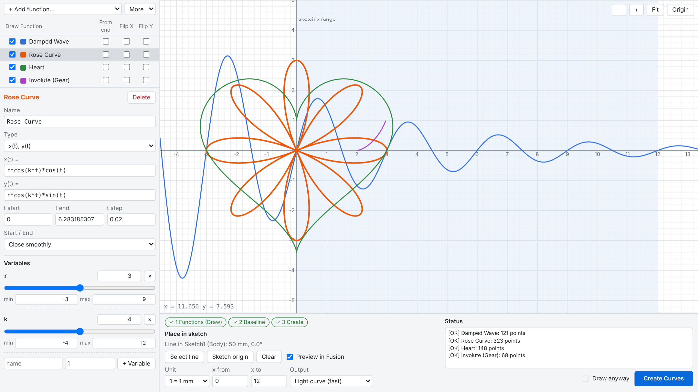

# Math Curve 2 for Autodesk Fusion

**English** | [日本語](#日本語)

Math Curve 2 is an Autodesk Fusion add-in that draws `y = f(x)` and parametric curves straight into your sketch.
Define a function, tune its variables on a live graph, and place it on any sketch line, all in one window.

- **Get it:** [Autodesk App Store](https://apps.autodesk.com/FUSION/en/Detail/Index?id=1343581627431012464) (30-day free trial)
- **Product page:** https://mekemeke-mkmk.github.io/math-curve-2/
- **User guide:** https://mekemeke-mkmk.github.io/math-curve-2/guide.html
- **Support:** mekemeke.lab@gmail.com
- **Privacy policy:** https://mekemeke-mkmk.github.io/math-curve-2/privacy.html

### Quick start
1. Install Math Curve 2 and start Autodesk Fusion.
2. Enter Sketch mode and choose **Create > Math Curve Sketch**.
3. Add a function or a preset, and tune it on the graph.
4. Click **Select line** and pick a sketch line, then click **Create Curves**.

This repository holds the product page and the user guide. The add-in itself is distributed through the Autodesk App Store.

---

## 日本語

Math Curve 2 は、`y = f(x)` や媒介変数の曲線を Fusion のスケッチにそのまま作成できる Autodesk Fusion 用アドインです。
関数を定義し、グラフで変数を調整し、好きなスケッチ線に配置するまでを、1つのウィンドウで行えます。

- **入手:** [Autodesk App Store](https://apps.autodesk.com/FUSION/en/Detail/Index?id=1343581627431012464)（30日間の無料体験版あり）
- **製品ページ:** https://mekemeke-mkmk.github.io/math-curve-2/
- **ユーザーガイド:** https://mekemeke-mkmk.github.io/math-curve-2/guide.html
- **サポート:** mekemeke.lab@gmail.com
- **プライバシーポリシー:** https://mekemeke-mkmk.github.io/math-curve-2/privacy.html

### かんたんな使い方
1. Math Curve 2 をインストールし、Autodesk Fusion を起動します。
2. スケッチモードで **作成 > Math Curve Sketch** を選びます。
3. 関数かプリセットを追加し、グラフで調整します。
4. **Select line** でスケッチ線を選び、**Create Curves** を押します。

このリポジトリには、製品ページとユーザーガイドを置いています。アドイン本体は Autodesk App Store で配布しています。

---

© 2026 MEKE MEKE. All rights reserved. The texts, images, and pages in this repository may not be copied or reused without permission.
本リポジトリの文章・画像・ページの無断転載・再利用を禁じます。

Autodesk and Fusion are registered trademarks or trademarks of Autodesk, Inc.
